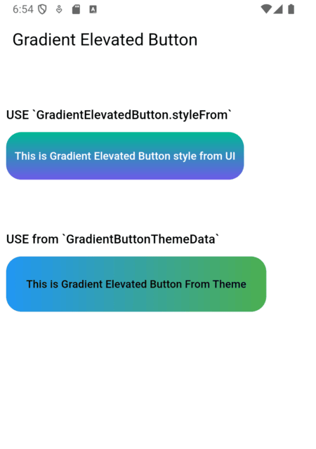

# GradientElevatedButton

[](https://pub.dartlang.org/packages/gradient_elevated_button)
[](https://github.com/ChegzDev/gradient_elevated_button/blob/master/LICENSE)
[](https://pub.dev/packages/gradient_elevated_button/score)
[](https://pub.dev/packages/gradient_elevated_button/score)
[](https://pub.dev/packages/gradient_elevated_button/score)

[//]: # ([![Publisher]&#40;https://img.shields.io/pub/publisher/gradient_elevated_button&#41;]&#40;fsd&#41;)


[//]: # (![Git Last Commit]&#40;https://img.shields.io/github/last-commit/ChegzDev/gradient_elevated_button?style=flat&#41;)
[//]: # ([![Git Stars]&#40;https://img.shields.io/github/stars/ChegzDev?style=flat&logo=github&#41;]&#40;fsd&#41;)
[//]: # ([![Git Followers]&#40;https://img.shields.io/github/followers/ChegzDev?style=flat&logo=github&#41;]&#40;fsd&#41;)
[//]: # ([![Languages]&#40;https://img.shields.io/github/languages/top/ChegzDev/gradient_elevated_button?style=flat&logo=dart&#41;]&#40;fsd&#41;)
[//]: # (![Git Contributors]&#40;https://img.shields.io/github/contributors/ChegzDev/gradient_elevated_button?style=flat&#41;)


[//]: # (![Team Chegz Dev]&#40;https://img.shields.io/badge/Team-Chegz%20Dev-blue?style=flat&logo=teams&logoColor=white&#41;)
[//]: # (![Flutter Developer]&#40;https://img.shields.io/badge/Flutter_Developer-blue?style=flat&logo=flutter&logoColor=white&#41;)
[//]: # (![Dart Developer]&#40;https://img.shields.io/badge/Dart_Developer-0175C2?style=flat&logo=dart&logoColor=white&#41;)

[//]: # (![Docs]&#40;https://img.shields.io/badge/Documentation-Available-brightgreen?style=flat&#41;)


[](https://www.buymeacoffee.com/chegz_dev)


A customizable elevated button with gradient support for your Flutter applications. This package allows you to create buttons with gradient backgrounds, custom foreground colors, and various other customizable properties using the `GradientElevatedButton` widget.

## Features

- **Gradient Background:** Easily apply gradients to your button backgrounds.
- **Customizable Style:** Customize text color, shape, padding, and more.
- **Integration with Theme:** Use `GradientButtonThemeExtension` (via ThemeExtension) to apply a consistent style across your app. (Old: `GradientButtonThemeData` is deprecated)


[Demo](https://github.com/ChegzDev/gradient_elevated_button/blob/master/example/lib/main.dart)




## Usage

### 1. Theming with ThemeExtension (Recommended)

The recommended way to theme all gradient buttons is to use `GradientButtonThemeExtension` with `ThemeData.extensions`:

```dart
MaterialApp(
  theme: ThemeData(
    extensions: <ThemeExtension<dynamic>>[
      GradientButtonThemeExtension(
        style: GradientElevatedButton.styleFrom(
          backgroundGradient: const LinearGradient(
            colors: [Colors.blue, Colors.green],
            begin: Alignment.centerLeft,
            end: Alignment.centerRight,
          ),
          foregroundColor: Colors.black,
        ),
      ),
    ],
  ),
  home: ...,
)
```

Then use `GradientElevatedButton` as usual:

```dart
GradientElevatedButton(
  onPressed: () {},
  child: Text('Themed Gradient Button'),
)
```

### 2. [DEPRECATED] Using GradientButtonThemeData

`GradientButtonThemeData` is deprecated and will be removed in a future release. Migrate to ThemeExtension as shown above.

```dart
// Deprecated usage:
GradientButtonThemeData(
  data: GradientElevatedButton.styleFrom(
    backgroundGradient: const LinearGradient(
      colors: [Colors.blue, Colors.green],
      begin: Alignment.centerLeft,
      end: Alignment.centerRight,
    ),
    foregroundColor: Colors.black,
  ),
  child: MaterialApp(
    // ...
  ),
)
```

### 3. Using GradientElevatedButton.styleFrom

Alternatively, you can style the `GradientElevatedButton` directly using `GradientElevatedButton.styleFrom` to define the button's gradient, shape, and other properties:

```dart

Widget gradientWidget = GradientElevatedButton(
  onPressed: () {

  },
  style: GradientElevatedButton.styleFrom(
    gradient: const LinearGradient(colors: [
      Color.fromARGB(255, 166, 206, 57),
      Color.fromARGB(255, 0, 175, 173),
    ],
      disabledGradient: const LinearGradient(colors: [
        Colors.grey.withAlpha(200),
        Colors.grey,
        Colors.grey.withAlpha(200),
      ],
        begin: Alignment.topCenter,
        end: Alignment.bottomCenter,
      ),
    ),
  ),
  child: const Text("This is Gradient Elevated Button"),
);
```  

## Customization
You can fully customize the GradientElevatedButton using the following properties:

- **backgroundGradient**: A `LinearGradient` (or other types) that defines the background gradient.
- **foregroundColor**: The color of the text and icon on the button.
- **disabledBackgroundGradient**: A `LinearGradient` (or other types) that defines the disabled background gradient.
- **disabledForegroundColor**: The color of the text and icon on the disabled button.
- **padding**: Padding inside the button.
- **shape**: Define the button’s shape with a `ShapeBorder` like `RoundedRectangleBorder` or `StadiumBorder`.
- **elevation**: Controls the button's elevation (default: 2).
- **onPressed**: The callback function that is called when the button is pressed.

## Migration Guide

To migrate from `GradientButtonThemeData` to the new `ThemeExtension` approach:
1. Remove `GradientButtonThemeData` from your widget tree.
2. Add `GradientButtonThemeExtension` to your `ThemeData.extensions`.
3. Use `GradientButtonThemeExtension.of(context)` to access the style if needed.
4. All `GradientElevatedButton` widgets will now use the theme from the extension.

See the example and code comments for more details.

## Example

[click here](https://github.com/ChegzDev/gradient_elevated_button/blob/master/example/lib/main.dart) for example


## Issues and Feedback

Please file any issues or provide feedback by visiting the [Issues and Feedback](https://github.com/ChegzDev/gradient_elevated_button/issues/new) for this repository.

For suggestions or further feedback, feel free to send an email to __chegz.dev@gmail.com__, and we'd be happy to hear from you!

### Contributors thanks


<a href="https://github.com/aissat/ChegzDev/gradient_elevated_button/graphs/contributors"></a>
